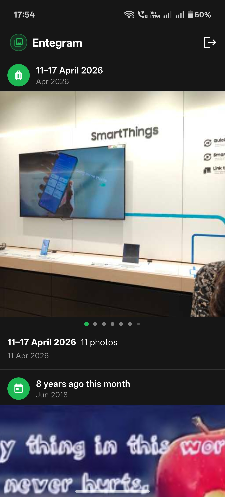
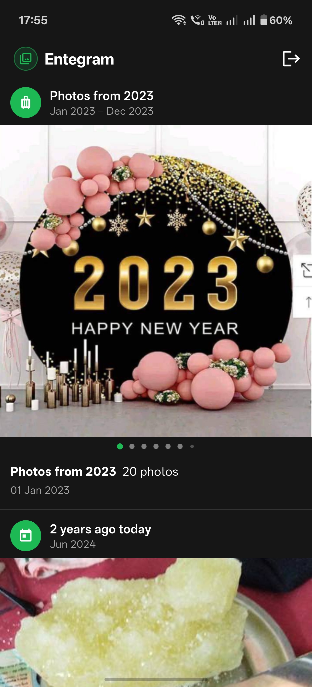
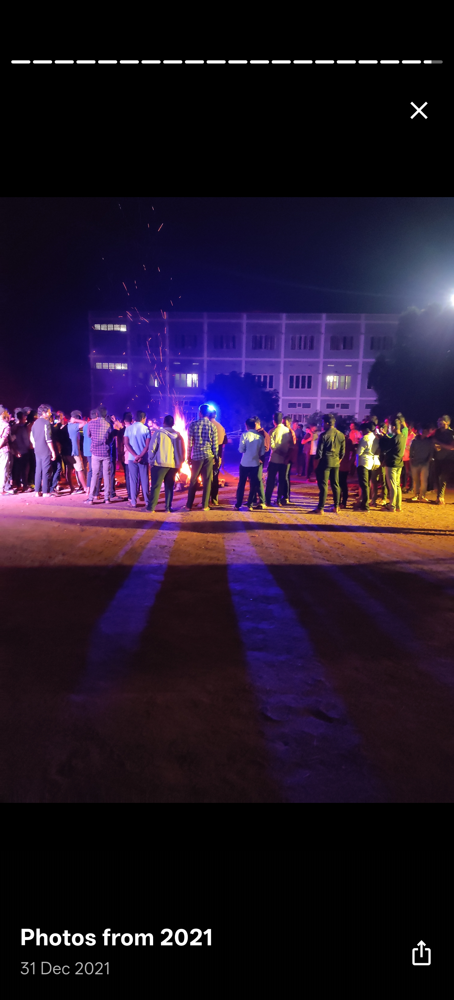

# Entegram

An Instagram-style **memories feed** and **stories viewer** for your [Ente Photos](https://ente.io) library — people, trips, "on this day", flashbacks, seasons and more, generated **on-device** from your end-to-end-encrypted photos.

> **A personal fan-boy project — not affiliated with Ente.** Entegram talks to the same API your official Ente Photos app uses, with your own account. Your password and keys never leave your device; all decryption happens locally. Works with both **ente.io** and **self-hosted** servers.

---

## Screenshots

| Memories feed | Year memory | Story viewer |
|:---:|:---:|:---:|
|  |  |  |
| Previous feed UI | Previous year-memory UI | Previous story UI |

---

## What it does

| Feature | Detail |
|---|---|
| **Curated memories feed** | A finite, varied selection with stable positions during sync, category filters, retryable pagination and phone/tablet layouts. |
| **Daily memories** | Exact-date anniversaries across your full archive, calendar month flashbacks and recent highlights. |
| **People** | Named-person highlights and co-occurrence-only pairs. Hidden people are excluded; the app does not guess who is “you.” |
| **Trips** | Away events with home confidence, return-home boundaries and bounded time windows. |
| **Year & seasonal highlights** | Samples spread across dates, hemisphere-aware seasons, and neutral quarters when GPS is unavailable. |
| **Stories** | Stable photo cards, per-account seen state, hold/manual/background pause, guarded async navigation and video-player-driven progress. |
| **Photo quality & variety** | Content-hash deduplication, screenshot filename filtering, distinct covers, bounded photo reuse and limited nearby prefetching. No external ML service is used. |
| **Zoomable originals** | Cached thumbnails upgrade to supported original formats; videos play only on the visible gallery page. |
| **Self-hosted friendly** | Media uses Ente’s production CDN workers or your configured server. |
| **End-to-end encryption** | Existing SRP login, Argon2id derivation and on-device libsodium decryption remain in place. |
| **2FA** | Authenticator-app TOTP support at sign-in. |
| **Sign out** | Removes synced database content, per-account media caches, story state and sync cursors. |

The curation and playback rewrite follows the daily-memory and highlight
patterns of Immich and Google Photos using the metadata available locally.
See [memory architecture, source review and tradeoffs](docs/MEMORIES.md) for
precise algorithms and validation limits.

---

## Getting started

### Prerequisites

- [Flutter SDK](https://docs.flutter.dev/get-started/install) **3.44.1** (Dart **3.12.1**), matching CI
- An [Ente Photos](https://ente.io) account (free tier works), or a self-hosted [Ente server](https://github.com/ente-io/ente)
- Android (tested) or iOS — other platforms may build but aren't actively supported

### Build & run

```bash
# 1. Clone
git clone https://github.com/RamNikhileshNunna/entegram.git
cd entegram

# 2. Install dependencies
flutter pub get

# 3. Generate Isar schema files (only needed after model changes)
dart run build_runner build --delete-conflicting-outputs

# 4. Run on a connected device / emulator
flutter run
```

### Sign in

Use your normal Ente email and password (plus a TOTP code if you have 2FA enabled). The app **never stores your password** — it derives your master key locally with Argon2id, exactly the way the official app does, then discards the password.

### Self-hosted server

Tap the **Entegram logo on the login screen 7 times** to open the server dialog, then enter your server URL (e.g. `http://192.168.1.10:8080`). "Reset to default" returns to ente.io. On self-hosted instances media is fetched directly from your server, so the CDN workers are never used.

---

## Architecture

```
lib/src/
├── auth/          Login, SRP key derivation, TOTP
├── crypto/        libsodium wrapper + on-device crypto isolate
├── db/            Isar models — EnteFile, EnteCollection, Person, MemoryCluster
├── media/         ThumbnailService, FullResService (concurrency + retry + circuit breaker)
├── memories/      MemoryEngine + MemoryMapper — local curation and stable persistence
├── network/       EnteApi (Dio REST client; CDN-worker vs. direct fetch)
├── sync/          SyncController, per-collection sinceTime cursors, ML data fetch
└── ui/
    ├── feed_screen.dart       Finite filtered feed with responsive lazy rows
    ├── login_screen.dart
    └── widgets/
        ├── stories_bar.dart      Rectangular daily memory cards
        ├── story_viewer.dart     Full-screen story player
        ├── memory_card.dart      Responsive memory card with a curated photo grid
        ├── fullscreen_viewer.dart Zoomable viewer with seamless thumb→original swap
        ├── person_chips.dart     Per-face name chips
        └── thumbnail_image.dart
```

State is managed with **Riverpod 3.x** and persisted in **Isar Community**. Memory curation runs in a worker isolate, stable identities survive rebuilds, and reactive file streams update visible cards as sync progresses.

---

## How it works

1. **Sync.** Recent-priority requests show useful photos quickly. Separate, persistent backfill cursors continue through the archive without skipping older files on restart.
2. **Decrypt locally.** The existing crypto isolate decrypts metadata and media with your account’s keys.
3. **Curate.** A worker groups exact anniversaries, people, trips, seasons, years and recent dates, then balances highlights and removes repetitive selections.
4. **Browse.** A responsive, unique feed and stable story rail show cached thumbnails; originals load on demand. Story playback respects loading, holds, zoom, lifecycle and explicit pause.

---

## Privacy & security

- **Read-only.** Entegram only reads from your library; it never modifies or deletes your photos.
- **Local decryption.** Crypto runs on-device in worker isolates. Session keys currently use SharedPreferences; see the [storage limitations](docs/MEMORIES.md#playback-and-responsiveness).
- **No password storage.** Your password is used once to derive the master key, then discarded.
- **Same API as the official app.** No extra scopes, no third-party servers. Sign out wipes the local DB.

The Ente API is **not officially documented for third-party use** and may change without notice. Review the source before trusting it with your account.

---

## Disclaimer

This is an independent personal fan-boy project. It is **not** endorsed by or affiliated with Ente Technologies. Use at your own risk.

---

⭐ **If you like this project, please give it a star** — it really makes my day and helps others find it.
